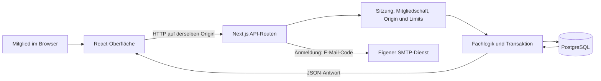

# Aufbau der Community

Die Website besteht aus einer Oberfläche im Browser, serverseitigen Schnittstellen und einer PostgreSQL-Datenbank. Wie bei einer Bibliothek ist die Oberfläche der Schalter, der Server prüft Berechtigung und Anliegen, und die Datenbank verwahrt den Bestand. Diese Analogie vereinfacht den Ablauf; die folgenden Dateien zeigen die tatsächliche Umsetzung.

## Vom Browser zur Datenbank

Die API ist der definierte Zugang vom Browser zum Server. Der Browser bekommt keinen Datenbankzugang. Die Anmeldung verwendet Better Auth; der Mailversand läuft über Nodemailer und einen konfigurierten SMTP-Dienst. Eine bestätigte E-Mail-Sitzung allein ist noch keine Mitgliedschaft. Die Quellkopie enthält keine aktive Produktionsanbindung.

## Technologie und Aufgabe

| Technologie | Aufgabe | Maßgebliche Quelle |
| --- | --- | --- |
| Next.js | Seiten, serverseitige API-Routen und Build | [src/app](../src/app/), [next.config.ts](../next.config.ts) |
| React | Interaktive Ansichten und Zustand im Browser | [components](../src/components/) |
| TypeScript | Typisierte Anwendungs- und Testlogik | [tsconfig.json](../tsconfig.json) |
| Tailwind und CSS | Gestaltung der Oberfläche | [globals.css](../src/app/globals.css), [PostCSS-Konfiguration](../postcss.config.mjs) |
| PostgreSQL und `pg` | Persistente Daten und Transaktionen | [db.ts](../src/lib/db.ts), [Migrationen](../migrations/) |
| Better Auth | E-Mail-Code-Anmeldung und Sitzungen | [auth.ts](../src/lib/auth.ts), [auth-database.ts](../src/lib/auth-database.ts) |
| Nodemailer / SMTP | E-Mail-Codes und optionale Betriebswarnungen | [auth.ts](../src/lib/auth.ts), [backup-monitor.ts](../src/lib/backup-monitor.ts) |
| Zod | Prüfung eingehender Daten | [security.ts](../src/lib/security.ts) |
| Node.js, npm, ESLint, Tests | Ausführen, Pakete installieren und Änderungen prüfen | [package.json](../package.json), [tests](../tests/) |

Exakte Versionen stehen ausschließlich in [package.json](../package.json) und [package-lock.json](../package-lock.json). Vercel, Neon und Brevo sind mögliche Dienste für Hosting, PostgreSQL und SMTP; sie sind keine im öffentlichen Repository enthaltenen Konten oder Zugänge. Eine eigene Umgebung wird in der [Technikdokumentation](technik.md) beschrieben.

## Die passenden Dateien zu deiner Frage

| Frage | Zuerst lesen | Danach bei Bedarf |
| --- | --- | --- |
| Wo beginnt die Seite? | [page.tsx](../src/app/page.tsx), [layout.tsx](../src/app/layout.tsx) | [community-app.tsx](../src/components/community-app.tsx) |
| Wie funktionieren Pinnwand und Formulare? | [community-app.tsx](../src/components/community-app.tsx) | [community-client.ts](../src/lib/community-client.ts), [feed-state.ts](../src/lib/feed-state.ts) |
| Wie funktioniert der Chat? | [group-chat.tsx](../src/components/group-chat.tsx) | [chat.ts](../src/lib/chat.ts), [chat-state.ts](../src/lib/chat-state.ts), [Chat-API](../src/app/api/chat/) |
| Wer darf etwas lesen oder ändern? | [identity.ts](../src/lib/identity.ts) | [access.ts](../src/lib/access.ts), [security.ts](../src/lib/security.ts) |
| Wie funktioniert Anmeldung? | [Auth-Route](../src/app/api/auth/%5B...all%5D/route.ts), [auth.ts](../src/lib/auth.ts) | [auth-client.ts](../src/lib/auth-client.ts), [auth-database.ts](../src/lib/auth-database.ts) |
| Wie werden Beiträge gespeichert? | [Posts-Route](../src/app/api/posts/route.ts), [content.ts](../src/lib/content.ts) | [db.ts](../src/lib/db.ts), [Grundschema](../migrations/001_initial.sql) |
| Welche Daten gibt es? | [Migrationen](../migrations/) in Nummernfolge | Historische Agententabellen sind kein aktiver Agentenzugang; siehe [Produktumfang](projekt.md) |
| Wie sind Fehler und Sicherheitsheader geregelt? | [http.ts](../src/lib/http.ts), [errors.ts](../src/lib/errors.ts) | [proxy.ts](../src/proxy.ts), [config.ts](../src/lib/config.ts) |
| Wie prüfe ich eine Änderung? | [Coding Standards](coding-standards.md), [package.json](../package.json) | [security.test.ts](../tests/security.test.ts), [community.test.ts](../tests/community.test.ts), weitere betroffene Tests |

## Beispiel: einen Beitrag erstellen

1. Die Oberfläche in `community-app.tsx` nimmt den Text entgegen und verwendet die Client-Helfer für die Anfrage.
2. `POST /api/posts` landet in `src/app/api/posts/route.ts`; die Route delegiert an `createContent` in `src/lib/content.ts`.
3. `actor` bestimmt die Identität und prüft den zulässigen Zugriff. `throttle` begrenzt Aufrufe; `readJson` und das Schema prüfen die Eingabe.
4. Innerhalb einer Datenbanktransaktion prüft `authorizeMutation` den Zugang erneut. Eine parametrisierte SQL-Anweisung speichert den Text mit der serverseitig bestimmten Mitgliedskennung.
5. Der Server antwortet mit der neuen Kennung und HTTP 201. Die Oberfläche verarbeitet die Antwort und lädt den Pinnwandstand nach. Dieses Nachladen darf die nächste Eingabe nicht dauerhaft sperren.

Die tatsächlich aufgerufenen Funktionen sind maßgeblich. Zum Lernen kannst du die KI mit dem [Ablaufauftrag](ki-lernguide.md#3-einen-beitrag-vom-klick-bis-zur-speicherung-verfolgen) durch diese Kette führen. Auch beim Bearbeiten und Löschen entscheidet der Server über das Eigentum; ein versteckter Button allein wäre kein Zugriffsschutz.

## Wo Weiterentwicklung beginnt

Für eine neue Funktion zuerst das gewünschte Verhalten im [Produktumfang](projekt.md) einordnen, den [Arbeitsstand](arbeitsstand.md) lesen und die betroffenen Schichten oben verfolgen. Eine rein visuelle Änderung betrifft häufig Komponenten und CSS. Neue gespeicherte Daten können zusätzlich eine neue Migration, Serverlogik, API und Tests benötigen. Bereits angewandte Migrationen bleiben unverändert.

Die [KI-Aufträge](ki-lernguide.md#6-eine-weiterentwicklung-zunächst-planen) führen von Erklärung über Planung zur lokalen Umsetzung. Prüfungen und Veröffentlichung sind getrennte Schritte. Es gibt in diesem Repository keine automatische Berechtigung, eine bestehende Community zu verändern.
